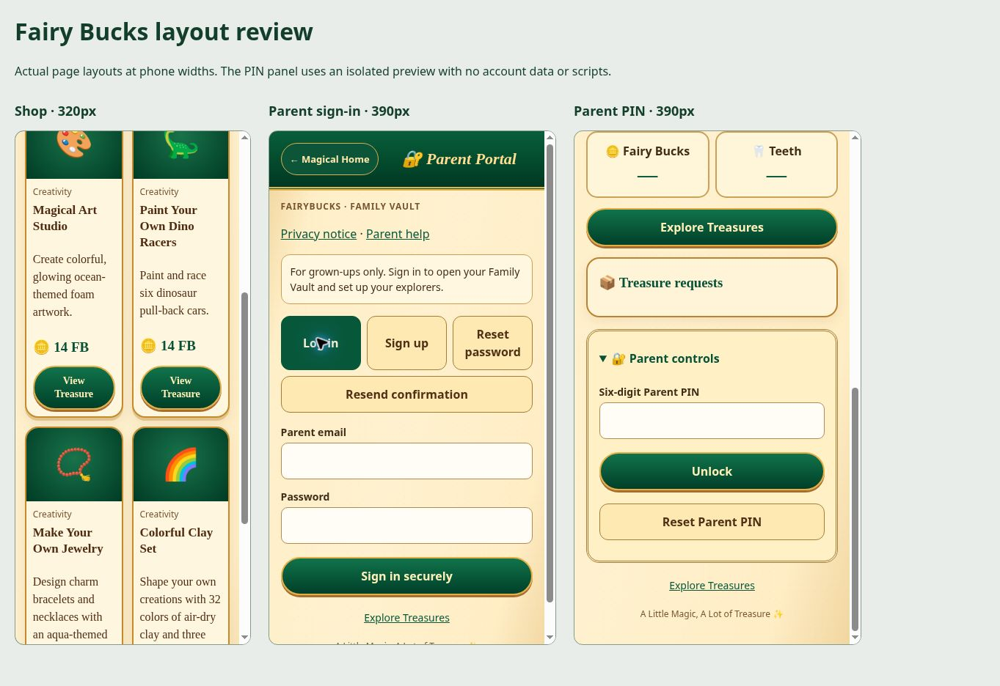

# Step 6 usability review

The shop's navigation and category controls were 34–37px tall. They now have a
44px minimum height; action buttons and disclosure summaries share that minimum.
Long labels can wrap. Treasure dialogs scroll within their height limit.

Parent help actions wrap with a 12px gap. The PIN reset action is full width with
an 18px gap below Unlock. Account-deletion PIN recovery also has spacing above it.

## Validation

- Live desktop review: public catalog, treasure dialog, signed-in family overview,
  explorer vault, and locked Parent controls.
- Managed browser preview: desktop shop controls measured 44px; no horizontal overflow.
- Narrow iframe layout review: 320px shop and 390px sign-in/PIN panel (including
  the browser scrollbar). No horizontal overflow; PIN buttons have an 18px gap.
- Category filtering, treasure dialog open/close, and login/signup tab switching worked.
- `cd tests && npm ci && npm test`: all existing database and UI behavior checks passed.
- `git diff --check`: passed.

The PIN panel in the screenshot is an isolated rendering of the actual markup
with scripts removed and no account data. It is not an unlocked production account.
Narrow iframe previews exercise responsive CSS, not native Safari or a phone keyboard.
After merge, verify the PIN spacing, wrapped help links and shop controls on a real phone.
The full parent-to-child handoff was not repeated during this layout pass.

This PR requires no SQL or database changes and does not enable staged permission flows.
